  

  <a href="https://metoushael.netlify.app"><b>metoushael.netlify.app</b></a> · logiciels desktop, web, mobile et IA

 

### `~/projets`

| Projet | Stack | Ce que ça fait |
|:--|:--|:--|
| [**mkulima-pay**](https://github.com/metoushael/mkulima-pay) | Kotlin · Compose · Firebase | Identité numérique et microcrédit pour les agriculteurs de la RDC |
| [**mex-engine**](https://github.com/metoushael/MEX-Engine) | C++ | Projet C++ |
| [**stocktout**](https://github.com/metoushael/STOCKTOUT) | Flutter · Dart | Gestion de stock et de ventes pour les boutiquiers |
| [**bulletin_scolaire**](https://github.com/metoushael/bulletin_scolaire) | Flutter · Dart | Saisie des cotes et génération des bulletins |

Sendy, Strate, VideoCompressor et Interview Prep AI sont sur le [portfolio](https://metoushael.netlify.app).

 

<!--
Serpent des contributions : à activer quand le compte aura de l'activité.
1. Ajoute .github/workflows/snake.yml, puis lance-le une fois (Actions > Generate snake > Run workflow).
2. Retire les marques de commentaire autour du bloc ci-dessous.

<picture>
  <source media="(prefers-color-scheme: dark)" srcset="https://raw.githubusercontent.com/metoushael/metoushael/output/github-snake-dark.svg">
  
</picture>
-->
